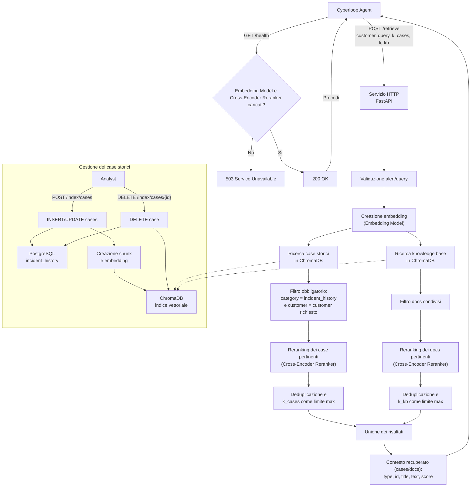

# Cyberloop RAG Service

Servizio RAG da integrare nell'infrastruttura Cyberloop. Tramite API, viene chiamato un Retrieve Agent che recupera contesto utile partendo dall'alert in input, 
servendosi del RAG (Retrieve Augmented Generation). Il resto dell'infrastruttura (Triage, Action Planning, Contenimento) non è incluso nella seguente repo.

- [Setup](#setup)
- [Download datasets](#download-datasets)
- [Avvio container](#avvio-container)
- [Popolare DB con datasets - in un altro Terminale](#popolare-db-con-datasets---in-un-altro-terminale)
- [Indicizzare knowledge base](#indicizzare-knowledge-base)
- [Invio alert e recupero del contesto](#invio-alert-e-recupero-del-contesto)
  - [Powershell](#powershell)
  - [Bash](#bash)
- [Workflow schema](#workflow-schema)

## Setup
```powershell
git clone https://github.com/floyddc/Cyberloop-RAG-Service.git  # oppure download della release
cd <REPOSITORY>
chmod +x *
echo "<HF_TOKEN>" > .env # sostituire con token HuggingFace, nel formato HF_TOKEN=xxxxxxxxxxxxx
pip install -r python/requirements.txt
```
- Sostituisci `HF_TOKEN` .

## Download datasets
```powershell
./fetch_datasets.sh
```

## Avvio container
```powershell
docker compose build
docker compose up
```
- Attendere che il servizio si avvii (`Application startup complete`) e restituisca `"GET /health HTTP/1.1" 200 OK`.

## Popolare DB con datasets - in un altro Terminale
```powershell
./seed_DB.sh
```
- Prima di avviarsi, dovrebbe restituire `PostgreSQL online`.

## Indicizzare knowledge base
```powershell
./build_index.sh
```

## Invio alert e recupero del contesto
- Modificare questi comandi per salvare il contesto recuperato e passarlo eventualmente ad altri agenti.

### Powershell
```powershell
$alert = Get-Content <ALERT_PATH> -Raw | ConvertFrom-Json
$body = @{
  customer = $alert.alert_customer_id
  alert = $alert
  k_cases = 0
  k_kb = 10
} | ConvertTo-Json -Depth 20 -Compress

$response = $body |
  curl.exe -sS -X POST http://localhost:8000/retrieve `
    -H "Content-Type: application/json" --data-binary "@-"

$results = $response | ConvertFrom-Json
$context = ($results | ForEach-Object { $_.text }) -join "`n`n"

$context
```

### Bash
```bash
file=<ALERT_PATH>

context=$(
  jq -n \
    --slurpfile alert "$file" \
    '{customer: $alert[0].alert_customer_id, alert: $alert[0], k_cases: 0, k_kb: 10}' |
  curl -sS -X POST http://localhost:8000/retrieve \
    -H "Content-Type: application/json" \
    --data-binary @- |
  jq -r 'map(.text) | join("\n\n")'
)

printf '%s\n' "$context"
```

## Workflow schema
